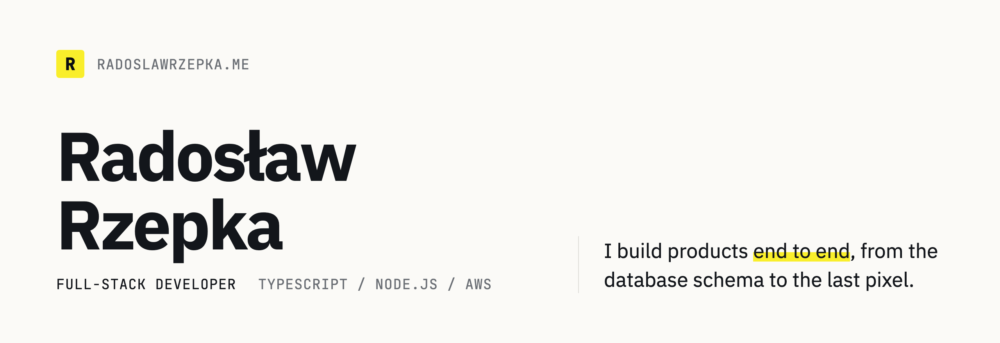

<picture>
  <source media="(prefers-color-scheme: dark)" srcset="./banner-dark.png">
  
</picture>

I work mainly on backends and cloud infrastructure with Node.js, NestJS, PostgreSQL and AWS,
and I build frontends in React and Next.js.

### Now

- **Node.js Developer at The Software House:** the backend of a platform used by brokers,
  which we are moving from a legacy system to a new set of services without interrupting
  the people who rely on it every day.
- **Co-founder of Reduko**, a platform for private tutors: architecture, backend and
  infrastructure on NestJS, PostgreSQL, Hetzner, Cloudflare and Pulumi.

### Experience

- `2026 → now` **Node.js Developer** · The Software House
- `2025 → 2026` **Fullstack Software Engineer** · Devopsbay
- `2023 → 2025` **Software Developer** · Gorrion

### Stack

`TypeScript` `Node.js` `NestJS` `PostgreSQL` `AWS` `Terraform` `Pulumi` `React` `Next.js` `Playwright`

### Certifications

- [AWS Certified Solutions Architect – Associate](https://www.credly.com/badges/526f7af0-eb95-47cf-b23b-7411436785d6) (2024)
- [AWS Certified Machine Learning Engineer – Associate](https://www.credly.com/badges/fc2a3844-ab21-4bb7-a83a-b678001c1d4b) (2025)

[radoslawrzepka.me](https://www.radoslawrzepka.me) · [LinkedIn](https://www.linkedin.com/in/radosław-rzepka-a87157248) · [kontakt@radoslawrzepka.me](mailto:kontakt@radoslawrzepka.me)
